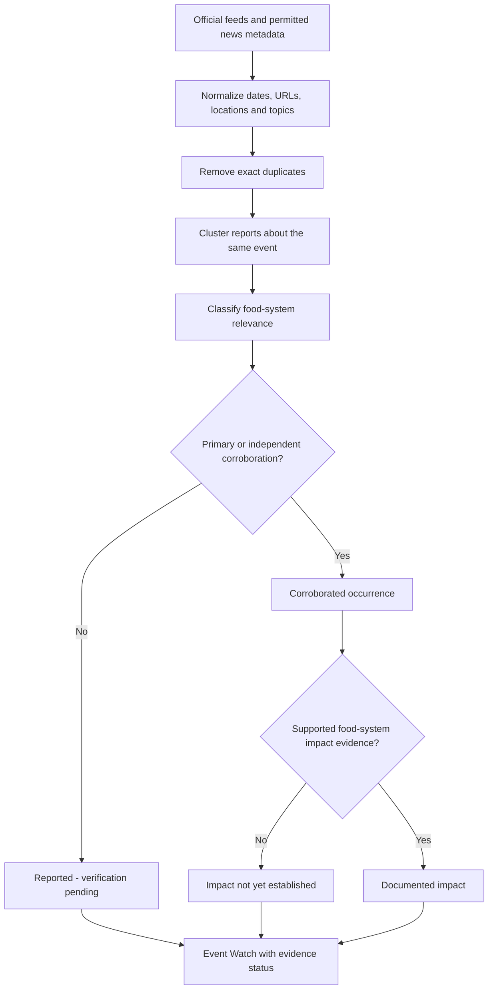
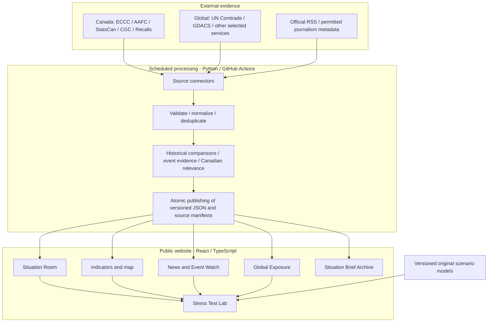

# Canada Food System Observatory & Stress Test

## A detailed concept note, research design, and development blueprint

**Working name:** Canada Food System Observatory (CFSO)  
**Tagline:** *From emerging signals to informed preparedness decisions*  
**Proposed GitHub repository:** `bdzion/canada-food-system-observatory`  
**Possible GitHub Pages URL:** `https://bdzion.github.io/canada-food-system-observatory/`  
**Proposed deployment option:** GitHub Pages initially; optional Vercel previews and server-side services  
**Version:** Concept note v2.0  
**Date:** 21 November 2026  
**Status:** Proposed project; no new repository, production data pipeline, or public website has been created as part of this document.

> **Institutional-status statement.** The project is motivated by ongoing food-system resilience research and an existing public demonstration associated with the University of Guelph/Arrell Food Institute context. Institutional roles, funding commitments, partnerships, logos, endorsements, data-sharing agreements and governance arrangements must be confirmed before they are described as formal. This concept note does not constitute an institutional endorsement or a government early-warning service.

> **Evidence-status statement.** The source links in this document were checked against available official documentation in November 2026. A documented API or downloadable feed is **not** equivalent to a fully tested, maintained connector. Each proposed source still requires an end-to-end test of current access, fields, terms of use, refresh behaviour and data quality.

---

## Executive summary

Canada's food system is simultaneously a major producer, processor, importer and exporter of agricultural and food products. Its resilience depends on weather and production conditions, food prices, agricultural inputs, transportation infrastructure, international trade, food safety, business continuity and the ability of institutions to respond to emerging disruptions. Relevant evidence exists, but it is dispersed across national statistics, departmental monitoring portals, international datasets, official alerts and news reporting. The information often has different spatial units, temporal frequency, provenance and degrees of verification. There is no single source that converts all these streams into a complete, validated picture of Canadian food-system risk.

The proposed **Canada Food System Observatory & Stress Test** will create a transparent and accessible web platform that connects four activities:

1. **Observe:** Retrieve selected Canadian and international indicators from reliable APIs and machine-readable datasets.
2. **Interpret:** Identify important changes, official alerts, and verified events, while communicating their scope and uncertainty.
3. **Connect:** Evaluate whether an international event has a plausible, documented connection to Canadian suppliers, production regions, trade flows or critical infrastructure.
4. **Explore:** Link important developments to an existing or proposed interactive stress-test scenario in which users examine hypothetical consequences of acting early, reacting late, or doing nothing additional.

The first product will **not** attempt to predict national shortages or issue automated emergency declarations. It will provide a reproducible national situation brief, interactive indicator cards, a verified event watchlist, and links to explanatory scenarios. A **Canada Relevance Filter** will distinguish global events of general interest from those with a demonstrable connection to Canadian food-system dependencies. This is intended as a useful innovation that is achievable with relatively simple data processing and rules, without requiring a trained AI model.

Development will begin in a **new GitHub repository** while preserving the existing [`bdzion/canada-food-stress-test`](https://github.com/bdzion/canada-food-stress-test) demonstration. Its seven illustrative single-shock simulation functions, compound-shock examples, and rail decision challenge can then be transferred into tested modules. Observed API data and simulated results will remain visibly distinct. The recommended initial infrastructure is a Vite/React/TypeScript interface, Python ETL scripts, scheduled GitHub Actions, versioned compact JSON outputs and GitHub Pages deployment. This has relatively low operational overhead. Vercel and a database can be introduced when there is a concrete need for authenticated workflows, protected APIs, larger event archives or computational services.

The result should be both a public research demonstration and a reproducible analytical foundation for future scientific work, including early-warning evaluation, exposure analysis, interview-grounded agent-based models and the empirical study of anticipatory interventions.

### At-a-glance project definition

| Item | Proposed decision |
|---|---|
| Primary product | Public, evidence-linked Canadian food-system situation dashboard |
| Secondary product | Integrated interactive food-system stress-test laboratory |
| Core audience | Policy analysts, researchers, industry and preparedness stakeholders |
| Main user question | “What has changed, why might it matter for Canada, and what could we examine next?” |
| Initial spatial coverage | Canada-wide with provincial/regional drill-down where available |
| International scope | Events and indicators with identifiable Canadian connections |
| Initial monitoring themes | Agricultural weather; food prices; grain/logistics; trade; verified disruptions |
| Initial evidence model | Observed data / reported event / corroborated event / documented impact / hypothetical scenario |
| Initial reporting cadence | Dynamic website plus reproducible weekly brief; faster source updates where justified |
| First technical strategy | Static site and automated data pipeline; no mandatory application server |
| Distinctive innovation | Traceable global-to-Canada relevance screening and evidence-to-scenario navigation |
| Deliberate exclusion | An unvalidated, all-purpose national “food crisis probability” or single risk score |

---

## Table of contents

1. [Background and problem definition](#1-background-and-problem-definition)
2. [Vision, purpose and research objectives](#2-vision-purpose-and-research-objectives)
3. [Operating principles, scope and non-goals](#3-operating-principles-scope-and-non-goals)
4. [Users, decisions and use cases](#4-users-decisions-and-use-cases)
5. [Platform modules and information architecture](#5-platform-modules-and-information-architecture)
6. [Detailed interface design and user journeys](#6-detailed-interface-design-and-user-journeys)
7. [National and international data-source registry](#7-national-and-international-data-source-registry)
8. [Indicator framework and analytical definitions](#8-indicator-framework-and-analytical-definitions)
9. [Verified news and event-intelligence system](#9-verified-news-and-event-intelligence-system)
10. [Global-to-Canada relevance and exposure analysis](#10-global-to-canada-relevance-and-exposure-analysis)
11. [Situation briefing and communication workflow](#11-situation-briefing-and-communication-workflow)
12. [Integration of the existing stress-test platform](#12-integration-of-the-existing-stress-test-platform)
13. [Technical architecture and infrastructure choices](#13-technical-architecture-and-infrastructure-choices)
14. [Canonical data models and APIs](#14-canonical-data-models-and-apis)
15. [Proposed GitHub repository and engineering workflow](#15-proposed-github-repository-and-engineering-workflow)
16. [Development roadmap and acceptance criteria](#16-development-roadmap-and-acceptance-criteria)
17. [Quality assurance, evaluation and learning](#17-quality-assurance-evaluation-and-learning)
18. [Governance, security, copyright and ethical safeguards](#18-governance-security-copyright-and-ethical-safeguards)
19. [Risks, dependencies and mitigations](#19-risks-dependencies-and-mitigations)
20. [Resourcing and operating model](#20-resourcing-and-operating-model)
21. [Research programme and possible scholarly outputs](#21-research-programme-and-possible-scholarly-outputs)
22. [Implementation-ready backlog and user stories](#22-implementation-ready-backlog-and-user-stories)
23. [Appendix A: example source configurations and schemas](#23-appendix-a-example-source-configurations-and-schemas)
24. [Appendix B: proposed scheduled workflow and pseudocode](#24-appendix-b-proposed-scheduled-workflow-and-pseudocode)
25. [Appendix C: developer/AI-agent implementation brief](#25-appendix-c-developerai-agent-implementation-brief)
26. [Source documentation and further reading](#26-source-documentation-and-further-reading)

---

## 1. Background and problem definition

### 1.1 Why a Canadian food-system situation platform?

Food-system conditions change through several overlapping pathways:

- **Production:** weather extremes, drought, crop disease, animal disease, labour availability and input access.
- **Processing:** concentrated facilities, equipment failures, energy prices and workforce interruptions.
- **Logistics:** rail disruptions, road closures, ports, cold chains, storage and distribution centres.
- **Markets:** commodity prices, food inflation, demand shifts, foreign policy and trade restrictions.
- **Imports and exports:** reliance on selected external suppliers, limited substitutes and international transportation dependencies.
- **Institutions:** communication delays, imperfect information, preparedness resources and coordination among public and private actors.

These pathways do not share one reporting system. Weather warnings may update frequently, grain movements weekly, wholesale prices on business days, CPI monthly, and trade and production data at longer lags. Media reporting may identify a new event long before official price or production statistics capture consequences. Combining such information without recognizing these differences can create false precision.

### 1.2 Problem statement

**The problem is fragmented situation awareness rather than simply a shortage of data.** Decision-makers must consult several websites and reconcile their scope, timing and reliability. There is limited systematic connection between (a) an observed change or event, (b) Canadian exposure to the affected activity, and (c) preparedness-oriented scenario analysis.

### 1.3 Opportunity

A carefully bounded web platform can create practical value by:

1. Bringing selected high-quality data into a consistent, sourced format.
2. Making changes and emerging developments easy to discover without overwhelming users.
3. Adding context through simple historical comparisons and geographic filters.
4. Screening global developments according to Canadian supply relationships rather than news prominence alone.
5. Presenting uncertainty and missing evidence as first-class information.
6. Connecting observations with the existing interactive stress-test demonstration.
7. Archiving observations and reports so research questions can be evaluated retrospectively.

### 1.4 Relation to the existing prototype

The existing [`Canada Food System Stress Test`](https://bdzion.github.io/canada-food-stress-test/) is a discussion-oriented demonstration. Its public repository states that it contains a national vulnerability register, seven tested threats, four possible compound-shock timelines, a rail decision game, and explicit caveats that results are illustrative rather than forecasts. In the current implementation, model logic and indicator definitions reside largely in a single HTML file with embedded JavaScript. The new project should preserve its working features, separate them into reusable modules, and add an independent evidence pipeline.

---

## 2. Vision, purpose and research objectives

### 2.1 Vision

A Canadian food system in which policymakers, researchers and supply-chain stakeholders can rapidly understand emerging conditions, identify evidence gaps and explore defensible opportunities for earlier preparedness.

### 2.2 Mission

**To connect trustworthy observations and verified events to an accessible, transparent and research-informed Canadian food-system situation update and stress-testing platform.**

### 2.3 Overall objective

Design, implement and evaluate an interactive national food-system observatory that integrates Canadian and relevant global data, systematic event monitoring, and illustrative scenario-based decision support.

### 2.4 Specific objectives

**O1 — Build a curated evidence layer.** Integrate a small, reliable collection of official APIs and machine-readable data sources, documenting their provenance, geography, reporting frequency and limitations.

**O2 — Detect and communicate changes.** Produce transparent and reproducible comparisons of selected variables with suitable historical baselines and show whether the latest observations are current, delayed or unavailable.

**O3 — Monitor verified developments.** Collect domestic and international alerts and news; group reports about the same occurrence; and distinguish a report of an event from verified effects on the food system.

**O4 — Establish Canadian relevance.** Use commodity and trade relationships, spatial evidence and supply-chain context to screen whether global events deserve further monitoring in Canada.

**O5 — Link monitoring with preparedness.** Create navigational links from observations and events to corresponding hypothetical stress-test scenarios, with explicit separation of observed data and model assumptions.

**O6 — Generate reproducible briefs.** Publish versioned daily change summaries and a concise weekly situation briefing, with citations and data-period labels.

**O7 — Support research and learning.** Create an auditable event/indicator history suitable for later validation, stakeholder evaluation and investigation of anticipatory decision-making.

### 2.5 Research questions

- **RQ1:** How can heterogeneous national and global food-system observations be integrated while preserving differences in timeliness, coverage and evidentiary status?
- **RQ2:** Which combinations of official indicators and verified events provide useful advance situational information for Canadian food-system stakeholders?
- **RQ3:** Can a transparent Canada Relevance Filter improve the precision and usefulness of international disruption monitoring compared with an unfiltered news stream?
- **RQ4:** How do users interpret and act on integrated monitoring evidence, and does linking it to stress-test scenarios improve preparedness conversations?
- **RQ5 (future empirical work):** How might verified earlier signals and response choices affect outcomes in a calibrated, interview-grounded supply-chain or agent-based model?

---

## 3. Operating principles, scope and non-goals

### 3.1 Design principles

1. **Canada first.** Every prominent international development must answer “Why could this matter for Canada?”
2. **Evidence before interpretation.** Observations, news reports, screening signals and simulations are separate information classes.
3. **Traceability.** Every material value and event has a source, URL, observation/event date, access time and transformation record.
4. **Small and useful.** A concise set of highly interpretable indicators is preferable to a large wall of disconnected data.
5. **No silent data gaps.** A failed API request is not a zero, and an old observation is not “live.”
6. **Historical comparability.** Price, trade, climate and logistics changes must use appropriate units, boundaries and seasonal references.
7. **Transparent screening.** Rules are reviewable; generated explanations never masquerade as verified facts.
8. **Progressive enhancement.** Begin with static hosting and scheduled processing; add servers and databases only as justified.
9. **Reproducibility.** Archive versions and tests so findings can be revisited.
10. **Accessible presentation.** Plain language, accessible colours, keyboard navigation, mobile usability and downloadable data where permitted.

### 3.2 Explicitly in scope for the minimum viable product (MVP)

- A national homepage with the latest validated source status and an automatically generated summary.
- A small number of official Canadian indicators with timelines and comparisons.
- An official alert and food-related event list.
- A source registry, method notes, timestamped status, and archive of weekly briefs.
- One global-to-Canada linkage demonstration based on trade and disasters.
- A clean, explicit link to the existing stress-test application; subsequently import its models.
- Automatic quality checks, error handling, and deployment.

### 3.3 Out of scope for the MVP

- Real-time tracking of every food business, facility, shipment or store inventory.
- Automated prediction of crisis probabilities without a validated forecasting model.
- An official emergency warning or policy recommendation system.
- A comprehensive, empirically calibrated Canadian agent-based model.
- Private-sector operational feeds without permission or data-sharing agreements.
- Automatic publication of unreviewed, high-impact or speculative AI-generated policy recommendations.
- Claiming that a global disaster causally produced a Canadian price change solely because the events occurred near one another in time.

### 3.4 Evidence classes used everywhere

| Class | What it means | Example | Display behaviour |
|---|---|---|---|
| **Observation** | Recorded value from a named data provider | Official weekly grain movement | Show value, unit and observation period |
| **Official alert** | An authoritative notice of a hazard, recall or government action | Weather warning or food recall | Show issuer, affected scope and issued/valid times |
| **Reported event** | Event claim discovered in media or third-party feed | A reported port disruption | Show “reported”; request corroboration |
| **Corroborated event** | Occurrence supported by suitable independent or primary evidence | Verified port closure | Show evidence and verification date |
| **Documented impact** | A specific operational or economic consequence supported by records | Confirmed shipment reduction | Show impact source and scope separately |
| **Screening signal** | Rule flags an observation for investigation | Unusual seasonal grain-shipment deviation | Show rule and baseline; not a confirmed crisis |
| **Scenario output** | Hypothetical result of specified model assumptions | Simulated cost under early response | Visibly labelled illustrative / modelled |

---

## 4. Users, decisions and use cases

| User | Typical question | Important view | What the system should **not** imply |
|---|---|---|---|
| Federal/provincial analyst | “Which developments merit checking this week?” | Situation Room + events | It is an official warning system |
| Agricultural policy researcher | “Are conditions unusual relative to prior years?” | Indicator Explorer | A statistical anomaly proves causation |
| Food processor or logistics stakeholder | “Are relevant transportation indicators changing?” | Logistics Pulse | Public aggregate data reveal one firm's inventory |
| Agriculture/food-sector organization | “Which international suppliers are relevant?” | Global Exposure | Import concentration equals an immediate shortage |
| Emergency management practitioner | “What decisions might be tested?” | Stress Test Lab | The illustrative model is a validated forecast |
| Research collaborator | “Can I reproduce the figure and report?” | Source and methodology pages | An uncited generated summary is evidence |
| Funding/partnership reviewer | “Is this feasible and research-worthy?” | Overview + methods + demonstration | All planned research capabilities already exist |

### Three representative user journeys

**Journey A — Domestic price monitoring.** A user selects “Fresh produce” and “Toronto,” views latest comparable wholesale-price observations, checks the change from a seasonally matched baseline, opens the original AAFC source and reads a brief note explaining what remains uncertain. The user can filter commodity and market; if comparable historical data are missing, the site reports that rather than manufacturing a trend.

**Journey B — International event relevance.** A user clicks an overseas disaster event. The platform displays its location and date, looks up historic Canadian import shares for a potentially affected commodity and shows whether a credible connection has been established. The event remains marked “potential exposure” until evidence of affected production or shipping is found.

**Journey C — Evidence to stress test.** A user identifies an unusual pattern in Canadian grain movements and opens the rail scenario. The stress-test page clearly states that any selected hypothetical duration or intervention efficiency is an assumption, not an automatically inferred estimate from the grain data. The user compares response strategies and downloads a scenario assumptions summary.

---

## 5. Platform modules and information architecture

The proposed website contains six user-facing modules and one shared methodological layer.

| Navigation | Main purpose | Essential components | MVP status |
|---|---|---|---|
| **Situation Room** | Rapid national situation awareness | Short brief, four theme cards, latest data periods, event highlights | Required |
| **Indicator Explorer** | Understand observed conditions | Trends, comparisons, filters, source details, missing-data states | Required |
| **News & Event Watch** | See credible emerging developments | Event clusters, verification status, date filters, source links | Basic official feeds first |
| **Global Exposure** | Explain why foreign developments may matter | Supplier shares, event linkages, limitations | One commodity pilot |
| **Stress Test Lab** | Explore hypothetical responses | Seven preserved scenarios, assumptions, timing comparisons | Link first; integration next |
| **Situation Brief Archive** | Retrieve and compare past reports | Weekly briefs, source manifest, date-specific context | Required |
| **Methods & Sources** | Inspect trust and research design | Source register, definitions, model assumptions, licences | Required |

### 5.1 Proposed homepage information hierarchy

1. **Page identity and status:** “Canada Food System Pulse”; last successful data-processing date; not an official alerting service.
2. **National summary:** Three to five evidence-linked sentences describing new and noteworthy **observed** developments and unresolved gaps.
3. **Four monitoring cards:** Production/weather; prices/markets; logistics; global connections. Each card shows latest observation date, change if available, and a link to details.
4. **What changed since the last update:** New/revised observations, newly corroborated events, and important source outages.
5. **Map and watchlist:** Only events with credible geographic data, filtered by geography and theme.
6. **Potential Canadian connections:** International events paired with a relevant trade/exposure record.
7. **Explore a scenario:** Link to one related stress-test exercise with a clear illustrative-model notice.
8. **Source and method footer:** Dataset status; methodology; archive; contact/feedback; disclaimer.

### 5.2 Low-complexity wireframe

```text
┌─────────────────────────────────────────────────────────────────────────┐
│ CANADA FOOD SYSTEM OBSERVATORY                           Methods | About │
│ Situation Room | Indicators | Events | Exposure | Stress Test | Briefs  │
├─────────────────────────────────────────────────────────────────────────┤
│ NATIONAL SITUATION UPDATE             Data processed: [UTC timestamp]    │
│ [Concise, sourced, automatically assembled narrative — not a forecast]   │
├─────────────────┬─────────────────┬────────────────┬──────────────────┤
│ WEATHER & CROPS │ FOOD PRICES     │ GRAIN MOVEMENT │ GLOBAL CONNECTION│
│ latest source   │ latest source   │ latest source  │ latest source    │
│ date + change   │ date + change   │ date + change  │ exposure context │
├─────────────────────────────────┬───────────────────────────────────────┤
│ CANADA MAP / LOCATION FILTERS   │ WHAT CHANGED / VERIFIED EVENT CARDS    │
│ Actual locations only           │ source • event time • verification   │
├─────────────────────────────────┴───────────────────────────────────────┤
│ IMPORTANT GLOBAL CONNECTIONS       [commodity] [country] [evidence]     │
├─────────────────────────────────────────────────────────────────────────┤
│ EXPLORE A STRESS TEST                  [Open illustrative rail scenario] │
├─────────────────────────────────────────────────────────────────────────┤
│ Previous briefs | Source health | Methods | Accessibility | Disclaimers │
└─────────────────────────────────────────────────────────────────────────┘
```

### 5.3 Interaction rules

- Selecting a province or commodity updates only supported datasets; unsupported filters show “not available for this source.”
- Tooltips never replace the visible axis labels or source information.
- Every card provides **View source**, **How calculated**, **View historical trend**, and, when appropriate, **Explore a scenario**.
- A “last refreshed” time is never substituted for a dataset's “observation period.”
- The site should not suppress an indicator merely because a high-profile event occupies the news.
- On mobile, the summary and four cards appear before maps and dense charts.

---
## 6. Detailed interface design and user journeys

### 6.1 Situation Room: national briefing

The Situation Room answers: **What has changed since the previous reliable update?** It is not intended to show every available chart at once. The summary is based on deterministic detection of newly published data and event records, followed by plain-language synthesis.

**Proposed headline format** (illustrative layout, not a current finding):

> **National situation update — [week ending date]**  
> **Agricultural conditions:** [verified change, named geography and data period].  
> **Market conditions:** [verified change for the selected commodity and market, or “no comparable new observation”].  
> **Supply-chain conditions:** [verified weekly grain movement comparison, or explicit data gap].  
> **International developments:** [event with corroboration status and Canadian relationship, or “no newly corroborated high-relevance items”].  
> **What merits review:** [questions, not automatic prescriptions].

The frontend should use neutral labels such as *latest observation*, *new official notice*, *outside historical reference range*, *reported event* and *confirmation pending*. It should avoid unqualified labels such as *Canada at high risk*.

### 6.2 Indicator Explorer: not just charts

An indicator detail view should combine:

1. **Definition:** exact measure and source.
2. **Current record:** value, unit, geography, observation period, release date.
3. **Trend:** a line chart or map with appropriate reference series.
4. **Comparison:** change since prior period; comparable seasonal baseline, where available.
5. **Coverage:** filters, sample or aggregation scope; missing dates; known reporting limitations.
6. **Interpretation:** a short, non-causal statement of what the observation suggests or does *not* show.
7. **Evidence link:** official source URL and source identifier.
8. **Next step:** relevant event card or illustrative stress test, if one exists.

### 6.3 News & Event Watch: event, not headline

Each event card should display: event title; location; event date; first publication date; most recent update; event type; named primary and corroborating sources; verification status; Canadian connection; known impacts; unresolved questions; and a link to related indicators and stress tests.

When multiple outlets repeat the same wire-service article, the system should display **one event with a shared underlying report**, not count every publication as independent corroboration.

### 6.4 Global Exposure: evidence-led storytelling

The Global Exposure view could ask a user to choose one of four commodity groups:

- Fertilizer inputs (e.g., selected HS classifications for phosphate fertilizers).
- Fresh produce (specific fruits or vegetables, with careful commodity coding).
- Grain and feed products.
- Energy and other critical agricultural inputs.

For each selection the site displays: historic supplier shares, period and units; relevant global events; strength of the geographical/commodity linkage; and what further evidence is needed to establish an actual Canadian impact. It must explain that **import concentration is not identical to total reliance**, because domestic supply, re-exports, substitution and inventory may be important.

### 6.5 Stress Test Lab: exploratory rather than predictive

The stress-test interface should offer a clearly labeled **Scenario settings** panel, an **Assumptions and sources** panel, a **Compare responses** view and an **Interpretation and limitations** panel. The model's version must accompany exported results. Users should be able to restore documented default settings at any time.

### 6.6 Situation Brief Archive

Every published brief should have a stable URL or immutable file name such as `2027-W05.md`, a source manifest, the period covered and a reproducibility identifier (e.g., Git commit SHA or processing-run ID). Later corrections should not silently overwrite what was originally published; publish an amendment or retain version history.

---

## 7. National and international data-source registry

**Interpretation key:** **API** means a programmatic endpoint; **geospatial service** means an OGC or ArcGIS service; **file feed** means an automatically downloadable CSV/JSON/XML/ZIP; **RSS** means a syndication feed; **candidate** means useful but requires additional technical/licence verification. All refresh frequencies below describe **proposed check schedules**, not promises about provider publication schedules.

### 7.1 Priority Canadian sources

| ID | Provider / dataset | Source and access | Recommended information | Proposed cadence | Initial use / limitations |
|---|---|---|---|---|---|
| CA-01 | **ECCC GeoMet** | [GeoMet OGC API](https://api.weather.gc.ca/), [OpenAPI](https://api.weather.gc.ca/openapi?f=html) | Weather alerts, selected forecast and observational features | Check hourly for chosen alerts; subject to source frequency | Official alert occurrence and locations; inspect relevant collections/geometry and use validity periods, not only issue dates |
| CA-02 | **AAFC Canadian Drought Monitor** | [CDM description](https://agriculture.canada.ca/en/canadian-drought-monitor), [ArcGIS ImageServer](https://agriculture.canada.ca/imagery-images/rest/services/canadian_drought_monitor/ImageServer) | Drought classes and monthly national geography | Monthly, after published update | Excellent agricultural context; NOT a daily drought reading; intersect with independently sourced agricultural areas only if geography supports it |
| CA-03 | **AAFC InfoHort Daily Wholesale Prices** | [Open-data record](https://open.canada.ca/data/dataset/920bc8e2-de26-4bf6-ac41-ed47962d0ff6); [JSON](https://od-do.agr.gc.ca/DailyWholesalePrices_PrixDeGrossistesQuotidiens.json); [dictionary](https://od-do.agr.gc.ca/DailyWholesalePricesDictionaryEn.html) | Toronto/Montreal wholesale price ranges, commodity and product attributes | Business-day check | Compare matching commodity, variety, country, package, grade and unit; wholesale is NOT retail price |
| CA-04 | **Statistics Canada Web Data Service** | [WDS](https://www.statcan.gc.ca/en/developers/wds); [user guide](https://www.statcan.gc.ca/en/developers/wds/user-guide) | Food CPI and selected agricultural/trade/economic series | Following data releases | Select and pin vetted table IDs, vectors, units and geographic levels; tables may be revised |
| CA-05 | **Canadian Grain Commission, Grain Statistics Weekly** | [Official weekly series](https://www.canada.ca/en/grain-commission/services/statistics/grain-statistics-weekly.html) | Grain receipts, shipments, deliveries, commercial stocks and exports | Weekly | Public CSV files; require crop-year/calendar alignment, revisions, units and facility categories |
| CA-06 | **Recalls and Safety Alerts** | [Open data page](https://open.canada.ca/data/dataset/d38de914-c94c-429b-8ab1-8776c31643e3); [JSON](https://recalls-rappels.canada.ca/sites/default/files/opendata-donneesouvertes/HCRSAMOpenData.json) | Food-related recalls, allergens, microbiological and other safety notices | Daily | Filter records to food categories; a recall is not automatically a national shortage |
| CA-07 | **Government of Canada News Centre** | [RSS information](https://www.canada.ca/en/news/subscribe-emails.html) | Official announcements by department/topic | Daily or several times/day | Reliable about what the government announced; verify event outcome separately; inspect individual feed URL before hard-coding |
| CA-08 | **AAFC Annual Crop Inventory** | [Agricultural production data entry](https://agriculture.canada.ca/en/agriculture-and-environment) | Crop distribution for agricultural exposure overlays | Annual | Geospatial crop classifications; use edition-specific resolution and accuracy metadata |
| CA-09 | **CFIA animal health information** | [CFIA information portal](https://inspection.canada.ca/en) | Animal disease and outbreak updates | As published | Structured data availability and terms vary by subprogramme; discovery/connector proof-of-concept required |
| CA-10 | **Canadian Centre for Cyber Security** | [Alerts and advisories](https://www.cyber.gc.ca/en/alerts) | Published cyber advisories affecting critical infrastructure | As published | A vulnerability advisory is not evidence of a confirmed food distributor outage |

**MVP recommendation:** build robust connectors for **CA-01, CA-03, CA-05 and CA-06** first, then add **CA-04** after selecting exact table/vectors and **CA-02** when geospatial handling is stable. Official News Centre feeds can be introduced early as a separate event stream. Avoid claiming CA-09 or CA-10 is fully machine-readable until each selected feed has been tested.

### 7.2 Priority global sources

| ID | Provider | Official docs / access | Information | Proposed cadence | Canadian use and cautions |
|---|---|---|---|---|---|
| GL-01 | **UN Comtrade** | [API documentation](https://comtrade.un.org/en/api-docs), [access options](https://comtradeplus.un.org/en/subscriptions) | Bilateral commodity imports/exports by period, reporter, partner and HS code | Monthly/annual updates as available | Map Canadian import suppliers; registration/quotas and commodity version harmonization must be managed |
| GL-02 | **GDACS** | [Official API/Swagger](https://www.gdacs.org/gdacsapi/swagger/index.html) | Global hazards and alerts with geography and dates | Several checks/day | Event discovery; disaster location does not necessarily overlap production facilities or export routes |
| GL-03 | **NASA POWER** | [Daily API docs](https://power.larc.nasa.gov/docs/services/api/temporal/daily/) | Gridded global historical/near-current weather variables | Daily as observations appear | Climate context for selected international supply regions; not a direct crop-yield forecast |
| GL-04 | **USDA FAS Open Data** | [Open-data portal](https://apps.fas.usda.gov/opendatawebv2/) | Production, Supply & Distribution (PSD), trade and export-sales data | Based on releases | Grain/oilseed stocks and global market outlook; inspect registration/access and projections versus observations |
| GL-05 | **FAOSTAT** | [FAOSTAT](https://www.fao.org/faostat/en/) | Agricultural production, trade and structural statistics | Annual/selected periodic | Longer-term exposure; limited suitability for daily monitoring |
| GL-06 | **IMF PortWatch** | [PortWatch](https://portwatch.imf.org/) | Port and maritime chokepoint activity | As published | Shipping activity context; linking maritime traffic to a specific Canadian commodity requires further route/trade evidence |
| GL-07 | **GDELT DOC 2.0** | [Documentation](https://blog.gdeltproject.org/gdelt-doc-2-0-api-debuts/) | Discovery of global reporting and article metadata | Hourly/daily bounded searches | Discovery only; media coverage not a verified food-system impact; respect publisher rights and GDELT terms |
| GL-08 | **ReliefWeb** (optional) | [API documentation](https://apidoc.reliefweb.int/) | Disaster/humanitarian reports | Daily | Useful contextual corroboration, especially for major overseas shocks; review API registration and coverage |
| GL-09 | **Energy Information Administration** (optional) | [EIA API](https://www.eia.gov/opendata/) | Petroleum and energy market indicators | According to series | Input and freight-cost context; US pricing is not equivalent to Canadian transaction prices |
| GL-10 | **World Bank Indicators** (optional) | [API information](https://datahelpdesk.worldbank.org/knowledgebase/articles/889392-about-the-indicators-api-documentation) | Structural macroeconomic/agricultural indicators | Annual/other | Research baseline, not real-time crisis signal |

**Global pilot recommendation:** integrate **GL-02 (GDACS)** for event discovery, **GL-01 (UN Comtrade)** for supplier links, and optionally **GL-07 (GDELT)** for discoverable reporting. Add crop/market data only after there is a documented scenario that needs them.

### 7.3 News and evidence-source policy

| Tier | Allowed examples | Role | Treatment |
|---|---|---|---|
| **Tier A: Original authoritative records** | Official weather warnings, government recalls, published statistics, formal closure notices | Establish a dated observation, notice or stated action | Record exact scope; authoritative about notice, not necessarily effectiveness |
| **Tier B: Independent credible reporting** | Established national and international journalism accessed through licensed feeds or lawful metadata links | Discover or corroborate developments; supply context | Preserve publisher, article URL and date; inspect whether reports share a single underlying wire source |
| **Tier C: Discovery/aggregators** | GDELT, curated public event-index feeds | Detect candidate stories or event clusters | Never treat coverage volume, sentiment or repeated headlines as impact estimates |
| **Tier D: Unverified social posts and rumours** | Public social-media discussion without reliable verification | Not part of MVP | Do not publish as confirmed events; optional future research under strict governance |

**Copyright/licensing rule:** Store URL, title where permitted, publisher, publication date, controlled metadata, and an original independent description. Do not reproduce entire copyrighted news articles or scrape websites contrary to terms. Government data are often subject to the [Open Government Licence – Canada](https://open.canada.ca/en/open-government-licence-canada/), but source-by-source attribution and exceptions still matter.

### 7.4 Source registry fields

The application should keep a machine-readable `sources.yml` or `sources.json` with:

`source_id`, `provider`, `dataset`, `documentation_url`, `retrieval_url_or_template`, `access_type`, `licence`, `attribution`, `credential_required`, `cache_policy`, `refresh_policy`, `expected_frequency`, `temporal_coverage`, `geographic_coverage`, `units`, `known_revision_policy`, `quality_checks`, `owner`, `status`, and `last_validated_at`.

A source status should be one of: `candidate`, `documented`, `prototype_connector`, `validated_connector`, `paused`, or `retired`. Avoid a misleading global “all sources live” message.

---

## 8. Indicator framework and analytical definitions

### 8.1 General calculation conventions

Every indicator must define **measurement grain** (e.g., day × market × commodity × grade), geographical extent, unit, source transformation, denominator, comparison period and missing-value rule. Some indicators are *conditions*, some are *exposure measures*, and some are *screening signals*. Do not combine them into one national index in the MVP.

For a value `x_t`:

- **Period-on-period change (percentage):** `100 * (x_t - x_(t-1)) / x_(t-1)` when the denominator is valid and not zero.
- **Seasonal reference anomaly (percentage):** `100 * (x_t - median(reference matching periods)) / median(reference matching periods)` if reference coverage, units and comparability are sufficient.
- **Year-over-year change (percentage):** `100 * (x_t - x_(t-12)) / x_(t-12)` for consistently defined monthly series with valid nonzero base, or use a provider-published equivalent.
- **Supplier concentration (share):** `import_value(Canada, commodity, partner, period) / import_value(Canada, commodity, all partners, period)` for identical commodity classification, measure and period.
- **Exposed area:** `area(official hazard geometry intersect relevant agricultural polygons)` with consistent projected units and known boundary coverage.

Percent changes are undefined for a zero baseline; show “not calculable,” not infinity. Missing observations remain `null`, never `0`, and revised historical values must be handled explicitly.

### 8.2 Core indicator dictionary

| Indicator ID | Measure and unit | Geographical/temporal grain | Baseline | Source | Material qualification |
|---|---|---|---|---|---|
| `wx_alerts` | Count of distinct, currently valid official weather alert features by selected type | Alert geometry × validity period | No historical anomaly required initially | ECCC GeoMet | Alert counts depend on warning geography, deduplication and alert updates |
| `drought_class_area` | Area or percentage of **mapped agricultural area** in specified official drought classes | Drought vintage × province/region | Previous monthly vintage and historical comparable months when available | AAFC CDM + crop exposure layer | Drought classes are monthly expert products; do not call them daily |
| `produce_wholesale` | Comparable wholesale price range midpoint or separately low/high, native unit | Market × commodity × grade × package × source date | Prior comparable record; same-season multi-year distribution | AAFC InfoHort | Units/packages/grading must match; aggregation across heterogeneous quotes is unsafe |
| `food_cpi_yoy` | Year-over-year change of a vetted food CPI series (%) | Canada or province × month | Same month prior year | Statistics Canada WDS | Choose exact published table/vector and confirm original index reference period |
| `grain_shipment_deviation` | Difference in same-category weekly grain shipment from matched crop-year week (%) | Crop-year week × grain × reporting category | Seasonally matched multi-year median | Canadian Grain Commission | Distribution, revisions, changes in coverage and crop-year definitions matter |
| `commercial_grain_stocks` | Stocks by commercial facility category and grain, tonnes | Week × category × grain | Similar crop-year week in previous years | Canadian Grain Commission | Not total Canadian food inventory; avoids unwarranted supply claims |
| `import_partner_share` | Share of Canadian import value or mass for a selected HS commodity and partner (%) | HS classification × partner × month/year | Prior year/rolling comparable period | UN Comtrade/StatsCan | Re-exports, reporting lags, HS revisions, confidentiality, value vs mass |
| `food_recall_events` | Count of unique food-related recall notices by scope and date | Notice ID × issue/update date | No crisis threshold initially | Canada recalls JSON | A recall count is not a direct estimate of food-system shortage severity |

### 8.3 How to select reference baselines

- **Wholesale prices:** do not compare different grades, units, packaging or markets. A small number of well-documented commodity–market combinations is preferable to a large aggregated index.
- **Grain statistics:** compare the same grain category, facility measure and crop-year week, including published revisions; report the number of valid historical years used.
- **CPI:** use the published definition and year-over-year transformation; do not mix index levels and percentage changes.
- **Weather alerts:** initially report official notices and their current validity rather than inventing a national severity metric.
- **Drought:** retain each monthly data vintage and official drought-class semantics.
- **Trade:** preserve whether flows are value, mass or quantity; do not add incompatible units across HS commodities.

### 8.4 Screening rules versus risk ratings

A transparent rule may flag `grain_shipment_deviation` if the latest value lies outside a historical percentile band computed from comparable weeks. The percentile and required sample size should be determined through retrospective testing, not chosen solely for visual effect. Such a flag should read **“Unusual movement — review suggested,”** not **“Confirmed rail crisis.”**

Proposed event/indicator states:

- `within_reference_range`
- `outside_reference_range_review`
- `official_notice_active`
- `reported_event_unverified`
- `event_corroborated`
- `impact_documented`
- `insufficient_data`
- `source_unavailable`

The first five are not interchangeable and should not share a one-dimensional numerical “risk score.”

---

## 9. Verified news and event-intelligence system

### 9.1 Why news belongs in a systematic update

News and official announcements can supply early context for transport closures, disease outbreaks, emerging policies and supply-chain incidents before those conditions appear in monthly economic statistics. They also introduce noise: duplicates, speculative headlines, incomplete event locations, and contradictory claims. The aim is **event intelligence with evidence**, not a media popularity dashboard.

### 9.2 Event pipeline



### 9.3 Minimum event-processing operations

1. **Acquire:** official RSS and open-data alerts first; global discovery from GDACS and bounded GDELT queries. For journalism use permitted title/URL metadata rather than republishing content.
2. **Normalize:** UTC timestamps with original timezone retained, canonical URLs, event keywords, country/province, commodity, severity if defined by provider, and incident identifiers.
3. **Deduplicate:** exact canonical URL, official incident ID and normalized title/date; maintain an audit trail of merged records.
4. **Cluster:** group candidates with similar named entities, geographic scope, time window and underlying event. Avoid merging separate events merely because they share a category (e.g., two unrelated floods).
5. **Classify:** issue, commodity, location, potential mechanism, primary source, and strength of evidence.
6. **Corroborate:** seek authoritative original notices or genuinely independent reporting. Repeated syndication from the same origin does not count as independent evidence.
7. **Assess impact independently:** confirm affected quantities, services, facilities, durations or market conditions when possible. If no impact evidence exists, show `impact_not_established`.
8. **Connect:** attach related indicators and, where justified, historical Canadian dependency data.
9. **Review:** an analyst approves higher-consequence public claims, corrections and external briefings.
10. **Publish and archive:** preserve original and revised event states, sources and review history.

### 9.4 Event model and evidence hierarchy

Each record should distinguish three propositions:

- **Occurrence claim:** Did something happen? (e.g., a closure was announced.)
- **Scope claim:** Where, when and which facilities/commodities were involved?
- **Impact claim:** What demonstrable effect occurred on food production, shipments, prices, availability or public safety?

These claims may have different sources and review statuses. For example, an official closure notice can establish a railway closure, but not the eventual dollar loss to Canadian agriculture.

### 9.5 News display and ethical constraints

The public site should present a short **original** summary, licensed/permitted metadata, source links and verified event details; not copied article bodies. The system should avoid publishing personal information about private individuals or confidential business operations. For potentially defamatory or commercially sensitive incident claims, require a higher review threshold. Do not present generated narrative as a quotation from an article.

### 9.6 Optional AI assistance (not mandatory)

An LLM may help extract candidate entities, draft a neutral one- to three-sentence summary, or organize long documents **only after** structured retrieval and licensing checks. Generated output must conform to a JSON schema, include source IDs, and pass claim-to-evidence review. It must not invent event dates, import shares, causal links or intervention effects. The first MVP can use rule-based text templates instead of an LLM.

---

## 10. Global-to-Canada relevance and exposure analysis

### 10.1 The innovation

Most global event feeds answer “What happened in the world?” The Observatory should answer **“What documented connection, if any, could make this relevant to Canada?”**

This can be done with a simple, auditable linkage engine that uses global events, country/commodity relationships and Canadian trade records. More sophisticated spatial supply-chain inference can follow later.

### 10.2 Proposed linkage levels

| Level | Evidence | Allowed public phrasing |
|---|---|---|
| L0: No established relationship | No relevant commodity, country or trade relationship identified | “No Canadian connection established from available data.” |
| L1: Country-level connection | Canada imports relevant commodity from a country where event occurred | “Historical supplier connection identified; specific impact unknown.” |
| L2: Commodity-region plausibility | Event overlaps a documented producing area or infrastructure corridor | “Potential exposure warrants investigation; disruption not verified.” |
| L3: Confirmed supply-chain effect | Reliable source confirms effect on commodity production, trade or shipping relevant to Canada | “Documented affected supply chain; Canadian consequence [if separately confirmed].” |
| L4: Documented Canadian outcome | Canadian market, trade, business or official data show a specified consequence | “Canadian impact documented for [measure/period/source].” |

These are **evidence-linkage stages**, not numerical estimates of likelihood, severity or the national economy's vulnerability.

### 10.3 Example case — foreign agricultural disaster

1. GDACS reports a flood with event identifier, coordinates and time.
2. The platform identifies country and affected subnational region if reliable boundaries exist.
3. A curated commodity list records products that Canada historically imports from that country (UN Comtrade; matched HS codes and year).
4. If only country-level trade is available, the site identifies **L1**, not a direct production impact.
5. Optional crop/geographic evidence tests whether the event intersects actual agricultural areas (**potential L2**).
6. A verified report may establish destroyed production, blocked exports or port closure (**L3**).
7. Canadian price and trade series can then be monitored for a documented Canadian response (**possible L4**, without assuming causality from co-occurrence).
8. If no direct evidence exists, the card says **“Canadian consequences not established.”**

### 10.4 Import dependency metrics

Compute for a *fixed HS classification, flow, unit and period*:

`partner_share = Canada imports from partner / Canada imports from all reporting partners`.

Report the numerator, denominator, HS code, nomenclature version, reporter, partner, data period and whether measure is value or mass. For broader exposure research, combine imports with domestic production, consumption, inventories and feasible substitute suppliers rather than relying on partner share alone.

### 10.5 Avoid five common analytical errors

- A source country experiencing a disaster does not establish damage to the specific export-producing region.
- Historical bilateral trade is not a contemporaneous shipping manifest.
- The largest import partner by value need not supply the largest tonnage.
- Negative news sentiment is not a direct economic loss.
- A model-estimated consequence should never be relabelled as an observed national shortage.

---

## 11. Situation briefing and communication workflow

### 11.1 Briefing cadence

- **Website:** latest successfully validated data, refreshed according to each source's actual publication cycle.
- **Daily change digest:** new official notices, newly retrieved observations and events that changed evidence state; omit empty claims.
- **Weekly national situation brief:** editorially structured evidence synthesis with date scope, selected trends, verified events, emerging questions and limitations.
- **Special update:** reserved for analyst-reviewed significant developments, not automatically triggered by unverified headlines.

### 11.2 Proposed weekly briefing template

```markdown
# Canada Food System Situation Update
**Reporting week:** [start–end]  
**Prepared at:** [UTC timestamp]  
**Data through:** [latest period shown separately by dataset]  
**Status:** Research intelligence briefing; not an official emergency alert

## National overview
[3–5 short evidence-linked sentences drawn from validated change records]

## What changed this week?
| Theme | Observation / verified event | Period | Evidence | Interpretation |
|---|---|---|---|---|

## Canadian agricultural and market conditions
[Key indicators with historical comparisons and limitations]

## Global developments relevant to Canada
[Event + supplier relationship + scope + unresolved questions]

## Evidence gaps and what to watch
[Source outages, pending official releases, uncertain event effects]

## Related stress tests
[Links to illustrative scenarios and assumptions, not official forecasts]

## Sources and methods
[Persistent URLs, source-vintage manifest, dataset definitions]
```

### 11.3 Repeatable editorial rules

- A statement of fact needs a source reference or a documented calculation from referenced data.
- Every observation includes its *own* period; a single brief date cannot stand in for monthly or annual data dates.
- “No new data” must not be rewritten as “conditions unchanged.”
- Contradictory sources must be shown as disagreement or pending review.
- Reported events should be linked to evidence status; never silently elevated by summarization.
- An externally circulated policy brief should pass human review and carry a version or correction record.
- Generated narrative should be bounded in length, avoid repetitive recitation and answer “Why should the reader care?” without unsupported conclusions.

### 11.4 Archive and correction policy

Save generated briefs in a dated archive, together with `run_id`, source manifest, transformation version and event/evidence snapshot identifiers. When a source revises a previous value, update the indicator history and create an amendment or versioned report; preserve the original published state for retrospective research.

---

## 12. Integration of the existing stress-test platform

### 12.1 What already exists

The existing public repo [`bdzion/canada-food-stress-test`](https://github.com/bdzion/canada-food-stress-test) and its README document these illustrative scenarios:

1. Prairie grain rail or port corridor disruption.
2. Phosphate fertilizer supply disruption.
3. Grocery distributor cyberattack.
4. Highly pathogenic avian influenza.
5. Prairie drought.
6. Loss of a major agricultural export market.
7. Disease-related meat-processing workforce interruption.

It also includes four compound-shock timelines and an interactive decision challenge. The current model functions are deterministic and explicitly illustrative. The combined-shock calculation currently includes an assumed overlap multiplier and response-delay penalty, not a calibrated multi-sector supply-chain network. The new platform must preserve this distinction.

### 12.2 Safe migration strategy

**Do not rewrite the model equations during the initial UI migration.**

1. Record a commit SHA of the original repository as the reference version.
2. Extract each pure JavaScript model function into a separate TypeScript/JavaScript module.
3. Capture a suite of fixed scenario inputs, expected outputs, units and calculation versions from the original.
4. Create regression tests that compare the new module's outputs with those fixtures within an explicitly stated numerical tolerance.
5. Move charting, interface logic and explanatory text separately.
6. Retain original default settings, labels and source notes unless there is an intentional, documented change.
7. Mark all example amounts as illustrative and maintain a visible link to the model's limitations.

### 12.3 Monitoring-to-scenario relationship

| Observed or verified condition | Corresponding scenario | Allowed automatic behaviour | Not allowed without validation |
|---|---|---|---|
| Official drought geography | Prairie drought | Suggest or open related drought scenario | Infer a calibrated livestock loss from drought class |
| Grain shipment anomalies / corridor notice | Rail disruption | Link related rail model and display event context | Set closure duration or economic loss as if observed |
| Fertilizer import concentration | Phosphate shortage | Preselect a commodity or display supplier relationship | Convert import share directly into realized shortage |
| Verified poultry disease notices | Avian influenza | Link to disease scenario | Treat all infected-premises counts as identical national production loss |
| Published cyber incident | Grocery distribution cyberattack | Offer a relevant what-if exercise | Infer retail inventory without company records |
| Trade restrictions and export dependence | Export-market disruption | Link to market-loss scenario | Present foreign policy news as quantified Canadian loss |

The simplest MVP uses **navigation rather than parameter auto-filling**. Later versions may prepopulate a documented subset of inputs *only* when mapping and model-validity conditions are satisfied, and should always allow users to distinguish imported values from assumptions.

### 12.4 Versioned scenario-run record

Every scenario result should record `scenario_id`, `model_version`, `inputs`, `input_class` (observed/assumed), `run_timestamp`, `output_units`, `source_manifest`, and `limitations`. Reproduction should be possible without needing a live external API at the moment of rerun.

---
## 13. Technical architecture and infrastructure choices

### 13.1 Architecture overview

A **static-first architecture** offers the best balance of capability, transparency and low maintenance for this project. Ingestion and calculations occur in scheduled jobs; the public website reads processed data rather than directly contacting every external provider.



### 13.2 Technology choices

| Layer | MVP selection | Why | When to reconsider |
|---|---|---|---|
| Language/UI | **TypeScript + React + Vite** | Modular UI, predictable builds, good support for testing and charts | Only if current team strongly prefers another stack |
| Styling | CSS variables or Tailwind CSS | Consistent responsive design | Avoid heavyweight component stacks unless useful |
| Charts | Recharts or Plotly | Accessible common charts and tooltips | Dense scientific analyses may require another charting layer |
| Map | Leaflet + OpenStreetMap tiles under appropriate usage policy | Simple geographic visualization | High-volume or complex geospatial layers may need hosted tiles/vector service |
| ETL | Python (`httpx` or `requests`, pandas, pydantic) | Straightforward data ingestion and validation | Larger pipelines may require orchestration service |
| Scheduled jobs | GitHub Actions | Uses existing GitHub workflow; easy audits and logs | Service-level uptime/reliability requirements exceed scheduled Actions |
| Storage | Source snapshots + compact validated JSON | Simple and reproducible | Rapidly growing event archive, user accounts or complex queries |
| Deployment | GitHub Pages | Sufficient for read-only dashboards built as static assets | Server-side features, protected APIs and authentication |
| Preview alternative | Vercel | Branch previews, possible functions | Confirm plan suitability for institutional/noncommercial use |
| Testing | `pytest`, Vitest, Playwright, schema validation | Regression and integration checks | Extend with load/security tests as system expands |

**Vercel note:** Hosting on Vercel does not itself improve scientific quality or generate live data. Its Hobby plan has personal, non-commercial restrictions; a university-linked or funded project should review [current plan terms](https://vercel.com/docs/plans/hobby) before using it in production. GitHub Pages can publish a compiled Vite/React site via [GitHub Actions](https://docs.github.com/en/pages/getting-started-with-github-pages/using-custom-workflows-with-github-pages). Static-first avoids recurring server costs until genuine server needs arise.

### 13.3 Data flow, handling source failures and atomic release

**Collector:** retrieves records with a user agent, timeout, bounded retries, API rate limits, and source-specific parsing. Credentials remain in GitHub Secrets, not source code or frontend bundles.

**Raw evidence:** optionally saves legally permitted source response metadata/checksums in a restricted pipeline artifact or an append-only archive. Not all licensed material should be retained in a public repository.

**Normalizer:** converts data into canonical records with units, precise periods, stable locations and citation references.

**Validator:** applies completeness, uniqueness, allowable range, date and schema checks, including source-specific invariants.

**Analyzer:** calculates comparisons, event status, event-to-Canada linkages and source health.

**Publisher:** writes new files to a temporary build location, verifies them, and then atomically replaces a named data manifest or publishes one coherent release. Never publish half-updated JSON for some sources while implying the entire dashboard was updated together.

**Frontend:** requests its own same-origin processed JSON files, displays original source data periods, and provides graceful stale-data/empty-state handling.

### 13.4 Recommended refresh schedule

| Process | Proposed run | Source reporting reality | Fallback |
|---|---|---|---|
| Weather alerts | Hourly / as suitable | Frequent | Show last valid source update and current validity, with source failure notice |
| Government notices / recalls | Every 6–12 hours | Event-based/daily | Retain last valid snapshot and show retrieval failure |
| InfoHort | Every business day | Business-day publications with reporting lag | Do not fabricate missing-day prices |
| CGC grain statistics | Weekly after expected release | Weekly | Preserve previous crop-year week data and mark pending |
| Statistics Canada | On release schedule / daily metadata check | Monthly or series-specific | Show last observation month |
| AAFC drought | Monthly | Monthly, often published after month end | Show assessment month explicitly |
| UN Comtrade | Monthly/quarterly check as selected | Variable publication and revision lag | Retain period and data vintage |
| GDACS | Several checks per day | Event-driven | Fail safely and mark event feed unavailable |
| Weekly situation brief | Once per week after selected source releases | Mixed periods | Include a source-period table and notable missing data |

GitHub scheduled workflows run in UTC and may be delayed during platform load; they are **not** guaranteed near-real-time timers. Align data-status messages to actual successful ingestion, not nominal cron times. See [GitHub Actions scheduling documentation](https://docs.github.com/en/actions/reference/workflows-and-actions/events-that-trigger-workflows).

### 13.5 Branch and deployment environments

- `main`: stable public version; only validated data bundles and reviewed features.
- `develop` or feature branches: connectors, UI and model work reviewed via pull requests.
- Pull request preview: rendered frontend with test or known-good snapshot data; do not expose private credentials.
- Production: reproducible build pinned to `package-lock.json` and `requirements.lock`/version constraints.
- Optional staging site: clearly labeled nonproduction and protected if it includes sensitive or unfinished content.

### 13.6 How a dynamic page stays fresh on static hosting

The frontend is static but the **data are periodically rebuilt**. A scheduled workflow queries an API, validates/normalizes records, and publishes `data/current/*.json`. The frontend then fetches those JSON assets and renders the current information. This is an API-based, automatically updated system without requiring every visitor's browser to call provider APIs directly.

The public site should show the *data manifest version* and *last successful ingestion timestamp*. If a producer's source changes unexpectedly, a failing connector should not corrupt the public dashboard.

---

## 14. Canonical data models and APIs

A strong schema matters more than the choice between Vercel and GitHub Pages. Each UI module should receive consistent, tested records.

### 14.1 Basic entities

| Entity | Essential fields | Notes |
|---|---|---|
| `Source` | `id`, `name`, `doc_url`, `licence`, `access_type`, `cadence`, `status` | One per external data product/feed |
| `Observation` | `id`, `indicator_id`, `source_id`, `value`, `unit`, `period_start/end`, `geography`, `dimensions`, `retrieved_at`, `quality` | Numeric or categorical; preserve `null` |
| `IndicatorDefinition` | `id`, `title`, `formula`, `grain`, `unit`, `baseline`, `allowed_filters`, `limitations` | Versioned documentation |
| `Event` | `event_id`, `type`, `event_time`, `place`, `sources`, `evidence_status`, `impact_status`, `last_reviewed_at` | Differentiate occurrence and impact |
| `CanadianExposure` | `event_id`, `commodity`, `trade_period`, `partner_share`, `linkage_level`, `rationale`, `data_sources` | An exposure record is not proof of impact |
| `SituationBrief` | `brief_id`, `reporting_period`, `generated_at`, `reviewed_at`, `data_manifest`, `sections`, `sources` | Immutable/revisable with history |
| `ScenarioRun` | `run_id`, `scenario_id`, `model_version`, `inputs`, `outputs`, `units`, `assumptions`, `timestamp` | Reproducible illustrative results |
| `PipelineRun` | `run_id`, `started_at`, `finished_at`, `connector_versions`, `test_results`, `published_manifest` | Audit trail |

### 14.2 Data-specific requirements

- **Dates:** ISO 8601 with offsets/UTC; observation period distinct from release and retrieval times. For date-only records use proper date fields.
- **Geography:** ISO 3166 country codes, Canadian province codes, source-specific polygons/coordinates where valid; distinguish point events from area-wide events.
- **Commodities:** retain source taxonomy and, when relevant, HS codes with classification edition; harmonize explicitly.
- **Money:** record currency, nominal/real basis, reference year, price unit and inflation adjustments if used.
- **Nullability:** `null` means unknown/missing, not zero; optionally add a `missing_reason` field.
- **Licensing:** include display/redistribution permissions per source; never publish disallowed raw payloads.
- **Quality status:** `validated`, `provisional`, `missing`, `stale`, `rejected` or `source_error` as appropriate.

### 14.3 Versioned JSON contracts

`data/manifest.json` should identify the latest coherent release and each resource's checksum. Prefer a stable schema version (`schema_version`) that can be checked before frontend rendering. If the UI receives an incompatible data schema, it must show a meaningful error rather than silently interpreting it incorrectly.

A basic user-facing data card can include:

- A value and native unit when available.
- Observation period and retrieval timestamp.
- Historical reference and comparator, if computed.
- Validation state.
- Link to original source.
- A limitation sentence.

### 14.4 Security and API usage

Static visitors should access processed public JSON rather than protected service credentials. Connector scripts should use environment variables from secure CI secrets, minimize provider requests, cache responsibly, respect rate limits and log failures without logging secrets. For a future server API, use authentication and role-based authorization where confidential partner data are present.

---

## 15. Proposed GitHub repository and engineering workflow

### 15.1 Suggested repository name

**`bdzion/canada-food-system-observatory`** (subject to availability and any institutional naming approval). Use a new repository rather than replacing the existing prototype. A clean project makes it easier to distinguish stable public material from experimental development.

### 15.2 Suggested structure

```text
canada-food-system-observatory/
├── README.md
├── LICENSE                         # choose only after reviewing rights
├── CONTRIBUTING.md
├── CODE_OF_CONDUCT.md              # optional, useful if open collaboration
├── CHANGELOG.md
├── package.json
├── package-lock.json
├── vite.config.ts
├── tsconfig.json
├── index.html
├── public/
│   ├── assets/
│   ├── data/                      # produced public JSON bundles
│   │   ├── manifest.json
│   │   ├── indicators.json
│   │   ├── events.json
│   │   ├── exposures.json
│   │   ├── source-status.json
│   │   └── briefs/
│   └── robots.txt
├── src/
│   ├── main.tsx
│   ├── App.tsx
│   ├── styles/
│   ├── components/
│   │   ├── Layout.tsx
│   │   ├── SourceBadge.tsx
│   │   ├── EvidenceCard.tsx
│   │   ├── DataFreshness.tsx
│   │   ├── TrendChart.tsx
│   │   ├── EventCard.tsx
│   │   ├── GeographyFilter.tsx
│   │   └── ScenarioLink.tsx
│   ├── pages/
│   │   ├── SituationRoom.tsx
│   │   ├── IndicatorExplorer.tsx
│   │   ├── EventWatch.tsx
│   │   ├── GlobalExposure.tsx
│   │   ├── StressTestLab.tsx
│   │   ├── BriefArchive.tsx
│   │   └── MethodsAndSources.tsx
│   ├── data/                       # schema types, loaders, validation
│   ├── models/                     # migrated and tested scenario functions
│   └── tests/
├── pipeline/
│   ├── pyproject.toml
│   ├── source_registry.yml
│   ├── connectors/
│   │   ├── eccc_weather.py
│   │   ├── aafc_infohort.py
│   │   ├── cgc_grain.py
│   │   ├── canada_recalls.py
│   │   ├── statcan_wds.py
│   │   ├── gdacs_events.py
│   │   ├── un_comtrade.py
│   │   └── official_rss.py
│   ├── schemas/
│   ├── normalize/
│   ├── quality/
│   ├── indicators/
│   ├── events/
│   ├── exposure/
│   ├── briefing/
│   └── tests/
├── scripts/
│   ├── run_pipeline.py
│   └── validate_public_bundle.py
├── docs/
│   ├── concept-note.md
│   ├── architecture.md
│   ├── indicator-dictionary.md
│   ├── evidence-and-news-policy.md
│   ├── model-assumptions.md
│   ├── source-inventory.md
│   ├── governance.md
│   └── evaluation-plan.md
└── .github/
    ├── workflows/
    │   ├── test.yml
    │   ├── refresh-data.yml
    │   └── deploy-pages.yml
    ├── ISSUE_TEMPLATE/
    └── PULL_REQUEST_TEMPLATE.md
```

### 15.3 Steps to create the repo (not executed)

1. Sign in to GitHub and create a new repository named `canada-food-system-observatory` under `bdzion` (subject to account visibility/permissions).
2. Choose **public** only if all included source code and example datasets can be openly shared; otherwise start private and decide publication scope later.
3. Create a README explaining the project as *proposed* and stating its non-official, non-forecast status.
4. Initialize a TypeScript/Vite application, add a simple home page, and commit the first working build.
5. Configure CI tests and GitHub Pages publishing via Actions with the correct Vite `base` path for the project URL.
6. Establish the source registry and common schemas **before** implementing multiple connectors.
7. Import **synthetic or clearly labelled example fixtures** for UI development; do not imply they are real observations.
8. Add one validated official data feed and its source-status page; then expand incrementally.
9. Import the existing stress-test functions with regression tests and model documentation.
10. Use pull requests for substantive changes and document release notes.

### 15.4 GitHub Pages path requirement

A project page hosted at `/canada-food-system-observatory/` needs its asset base path configured appropriately (e.g., Vite `base: '/canada-food-system-observatory/'`). Incorrect paths are a frequent cause of white/blank pages or missing chart bundles after deployment.

### 15.5 Team branching policy

For a solo research prototype, a light policy is sufficient: `main` stable; short-lived `feature/...` branches; tests before merge; small release notes; CI secrets protected. With multiple developers, add reviewer requirements, dependency updates, automated accessibility checks and source-connector ownership.

---

## 16. Development roadmap and acceptance criteria

**Illustrative schedule only:** The following is a staged planning scenario for a part-time researcher/developer with AI coding assistance and occasional methodological review, **not** a promised duration or budget. Re-scope after inspecting actual API payloads and the desired institutional review process.

| Stage | Indicative effort block | Functional deliverable | Release gate |
|---|---|---|---|
| **0. Foundation** | Weeks 1–2 | New repo, build, design system, source registry, evidence classes | Site deploys reliably; schemas and disclaimers visible |
| **1. National data MVP** | Weeks 3–5 | ECCC, InfoHort, CGC and recalls connectors; Situation Room | All four connectors tested; missing data and source periods correct |
| **2. Indicators & briefing** | Weeks 5–7 | Comparable trend charts, source cards, archive, weekly template | Indicator definitions reviewed; report reproducible |
| **3. News & events** | Weeks 7–9 | Official RSS/event collection, deduplication, event evidence cards | No unverified article presented as confirmed impact |
| **4. Global relevance pilot** | Weeks 9–11 | GDACS + selected Comtrade product/country link | Clear L0–L4 evidence relationship; absence of evidence visible |
| **5. Integrated Stress Test** | Weeks 11–13 | Seven migrated scenarios, regression tests, decision challenge | Fixed model fixtures match original outputs |
| **6. Validation & demonstration** | Weeks 13–15 | Stakeholder walkthroughs, methodological notes, release candidate | QA and usability evidence documented; deficiencies triaged |

Sequence can overlap, but the **release gates** should not be skipped.

### 16.1 Definition of done for the first public release

A first public release is complete only when:

- The Situation Room loads on desktop and mobile and works with keyboard navigation.
- Four selected official sources have successful end-to-end retrieval, transformations and accessible source records.
- Every displayed value includes a correctly labelled observation period, unit, geography and source link.
- At least one indicator chart demonstrates a valid historical comparison, including its baseline rule.
- A failed or stale source produces a clearly marked state without fabricated data.
- Official news or recalls appear as structured event cards, not unsourced text.
- Weekly briefing can be reproduced from a recorded data manifest.
- The existing Stress Test is reachable through explicit navigation and marked illustrative.
- A test suite checks schema compliance and the principal data transformations.
- The site includes institutional-status, research-use and licensing notices.

### 16.2 Definition of done for the integrated release

In addition to the above:

- The seven existing model functions pass regression tests against original model fixtures.
- The rail decision game remains functionally equivalent or has documented, tested improvements.
- The global pilot links an event to an appropriate commodity/country trade record and clearly states linkage limitations.
- Duplicated reporting is collapsed into event clusters with provenance.
- Users can inspect and export a source-backed scenario/brief record without changing the scientific interpretation.

---

## 17. Quality assurance, evaluation and learning

### 17.1 Data-quality dimensions

| Dimension | Validation operation | Expected failure handling |
|---|---|---|
| Availability | HTTP status, completeness, expected schema | Mark source unavailable; keep known-good snapshot |
| Freshness | Observation end date vs expected publication schedule | Show “older than expected”; do not invent a current value |
| Uniqueness | Stable IDs, time+geography+commodity keys | Deduplicate, quarantine conflicting records |
| Completeness | Required fields present and non-null where expected | Exclude incomplete comparisons or display limited scope |
| Validity | Native units, allowed categorical values, valid date bounds | Reject impossible or malformed records |
| Comparability | Same grade, package, year definition, geographic aggregation | Do not calculate unsupported percentage changes |
| Revision integrity | Source updated a historical period | Update vintage; preserve difference/audit log |
| Provenance | Source, URL, retrieval time, transform version | Block public publication if critical lineage is absent |

### 17.2 Test strategy

**Unit tests:** source parser fixtures, comparison formulas, date parsing, missing-value rules, supplier-share denominators, event status logic, deterministic briefing templates.

**Integration tests:** selected official endpoint contracts using bounded requests, response-format checks, and temporary network-failure simulation.

**Frontend tests:** filters, accessibility labels, empty states, route navigation, source links, map interaction, print/PDF formatting where supported.

**Regression tests:** migrated scenario results against the existing prototype's reference output fixtures.

**End-to-end tests:** full ingestion → validated JSON → deployed page → visible accurate observation period and source attribution.

**Security checks:** dependency audit, secrets scanning, repository permissions, licensing guardrails and disclosure of build/runtime metadata.

### 17.3 Evaluation framework

| Evaluation domain | Example observable measure | Why it matters |
|---|---|---|
| Data integrity | Fraction of published indicator records passing schema/provenance checks | Basic evidence reliability |
| Timeliness | Difference between source publication and successful ingestion | Operational usefulness |
| Source coverage | Number and type of sources with valid current observations | Avoids misleading “national completeness” |
| Event precision | Analyst-reviewed share of flagged events judged relevant | Limits event-monitoring noise |
| Duplicate reduction | Repeated reports correctly grouped by underlying occurrence | Avoids inflated event counts |
| Explanatory traceability | Fraction of key statements with source/derived-value references | Trust and auditability |
| Usability | Time to answer defined user tasks in moderated walkthroughs | Practical stakeholder utility |
| Accessibility | Automated and manual checks; keyboard/screen-reader test outcomes | Inclusive use |
| Research usefulness | Ability to recreate a past brief and its indicator state | Reproducibility |

No numerical performance targets are asserted before a baseline evaluation. Provisional operational thresholds can be proposed after two or more complete update cycles and a representative historical backtest.

### 17.4 Retrospective evaluation and alert quality

For a pilot such as railway disruptions, create an independent reference chronology of **documented events**. Compare event-screening output with that reference using precision, recall, detection delay and false-positive descriptions. Separate timely detection of a reported closure from prediction of its economic consequences. Evaluate whether monitoring improves users' questions and decision readiness; do not claim verified avoided losses without an empirical intervention evaluation.

### 17.5 Human review and publication audit

An analyst should review major events, corrections and any policy-facing weekly briefing. The review record includes reviewer role, date, claims checked, source links, unresolved caveats and final publication disposition. A simple checklist is sufficient for the early prototype.

---

## 18. Governance, security, copyright and ethical safeguards

### 18.1 Intended governance

A minimal governance arrangement can separate three roles even if one person initially performs more than one:

- **Data steward:** source inventory, licensing, transformations, quality monitoring.
- **Scientific/methodological reviewer:** indicator definitions, model limitations, causal language and scenario assumptions.
- **Editorial/product reviewer:** public-facing language, design, briefing approval and corrections.

Institutional ownership and editorial approval responsibilities need explicit agreement if the platform becomes an official research output of a partner organization.

### 18.2 Copyright, licences and attribution

The [Open Government Licence – Canada](https://open.canada.ca/en/open-government-licence-canada/) generally enables reuse with attribution for applicable government information, but individual records can have caveats and third-party materials may be excluded. Each source registry entry must record the licence. Newspaper article text and photographs are ordinarily copyrighted; provide links and permissible metadata, not scraped full-text republishes. Dataset licences should be checked before making a public bulk-data archive.

### 18.3 Credentials and repository hygiene

- Keep API keys in GitHub Actions secrets or an appropriate server-side secret manager.
- Never commit tokens, private emails, personal identifiers, partner data or restricted payloads.
- Use least-privilege GitHub token permissions for CI and deployment.
- Pin dependencies or use lockfiles; review external packages.
- Validate all untrusted source text before rendering (escape text and avoid dangerous HTML insertion).
- Rate-limit requests, document contact details where needed and follow provider terms.
- Back up or version source manifest and published reports.

### 18.4 Research ethics and sensitive information

The public MVP uses open data and permitted public metadata. Future interview-grounded modelling, stakeholder accounts, or confidential commercial inputs may require institutional research ethics and data-sharing approval, including data retention and access controls. Public GitHub datasets should not include confidential interview transcripts, business inventories or identifiable participant information.

### 18.5 AI governance

AI-assisted code generation or editorial drafting should be documented where material. Generated text is never treated as an independent source; each substantive factual statement must link to evidence. A model should not silently invent causal explanations or recommend activating interventions. High-stakes policy-facing content needs human approval before release.

### 18.6 Non-official and non-predictive disclaimer

Recommended website footer language:

> **Research prototype:** This platform integrates publicly available evidence for research, discussion and preparedness analysis. It is not a Government of Canada monitoring service or an official alerting system. External source data may be delayed or revised. Scenario results are illustrative unless explicitly identified as independently validated.

---

## 19. Risks, dependencies and mitigations

| Risk | Effect | Likelihood to plan for | Mitigation | Owner role |
|---|---|---|---|---|
| API schema change or endpoint outage | Broken updates and incorrect rendering | Material | Source registry, pinned parsers, quality gates, stale-data banner | Data steward |
| Mixed data frequencies | False appearance of “real-time” national assessment | Material | Observation and release dates per indicator; source-status page | Scientific reviewer |
| News duplication and misinformation | Inflated or false risk reporting | Material | Event clustering, primary sources, review gates | Editorial reviewer |
| Confusing global events with Canadian impacts | Unsupported national consequence claims | Material | L0–L4 evidence linkage, explicit uncertainty | Scientific reviewer |
| Wrong commodity/HS mapping | Misleading trade exposure | Material | Curated mapping, nomenclature version, manual validation | Data steward |
| Revisions to historical data | Briefs appear inconsistent | Material | Vintages, run manifests, correction log | Data steward |
| Large web-scraped or licensed content storage | Copyright/privacy exposure | Material | Links/metadata only; licence review; avoid scraping article bodies | Governance lead |
| Model parameter contamination | “Observed” numbers mixed with illustrative losses | High-consequence | Input provenance classes, model tests, scenario disclaimers | Scientific reviewer |
| Uncontrolled feature scope | Delayed usable release | Material | MVP gates, “one connector at a time,” backlog prioritization | Product lead |
| Institutional branding without approval | Misunderstood affiliation or endorsement | Material | Neutral project branding until formally authorized | Governance lead |
| Hosting cost or plan conflict | Interrupted public operation | Variable | Static-first hosting, cost alerts, plan/terms review | Technical lead |
| GitHub Actions schedule delay | Brief refresh later than expected | Material | Actual-success timestamps, re-run controls, manual trigger | Technical lead |
| Lack of long-term maintainer | Stale public information | Material | Documented runbook, source ownership, status banner/retirement procedure | Project lead |

The “likelihood to plan for” entries are qualitative project-management priorities, not empirical probabilities.

---

## 20. Resourcing and operating model

### 20.1 Roles and responsibilities

A small working team can deliver the MVP if roles are clearly defined:

- **Research/product lead:** user needs, project boundaries, data relevance, science-to-policy communication.
- **Full-stack developer (part time or AI-assisted):** frontend components, CI/CD, map/chart integration, user experience.
- **Data/ETL developer (potentially the same person):** connectors, schemas, QA and historical calculations.
- **Methods adviser:** measurement definitions, event interpretation and model limitations.
- **Stakeholder reviewers:** limited structured feedback on usability and relevance.

One researcher can prototype several roles, but independent scientific and editorial review is desirable before formal policy distribution.

### 20.2 Indicative cost categories (not vendor quotations)

| Component | Low-complexity option | Potential additional cost |
|---|---|---|
| GitHub repository and public static website | GitHub + Pages within applicable plan terms/limits | Organization plans, build/storage usage, custom domain |
| Scheduled processing | GitHub Actions within included usage | Extra minutes, paid orchestration, monitoring |
| Python and JavaScript tools | Open-source libraries | Developer time, security maintenance |
| Data feeds | Selected public government feeds | API subscriptions, commercial media rights or premium data |
| Maps | Appropriate open basemap/tiles for low traffic | Hosted map tiles, commercial geospatial services |
| Storage | Small public JSON bundles and Git history | Database, object storage, backup and logs |
| Vercel | Optional preview/application deployment | Paid plan/usage and institutional eligibility |
| Validation and stakeholder review | Research staff time | External expertise, partner data agreements, governance |

A **real operating budget** should be developed after source and hosting selection, observed data volumes, user estimates, expected refresh frequency, and any institutional procurement requirements are known. Do not treat a vendor's free tier as a guaranteed permanent institutional hosting arrangement.

### 20.3 Maintenance cadence

- **Daily automated:** connector run and error log review for selected fast feeds.
- **Weekly human:** validate national brief, review material events, confirm source and data statuses.
- **Monthly:** audit indicators, source revisions, analytical thresholds, accessibility and dependency updates.
- **Quarterly:** evaluate usefulness, remove unhelpful metrics, inspect event-monitoring precision and refresh scenario/model documentation.

---

## 21. Research programme and possible scholarly outputs

The Observatory is a research **infrastructure and method**, not itself proof that early warning prevents crises. It can support future studies that explicitly test this proposition.

### 21.1 Research Stream A: Reproducible food-system situation intelligence

**Question:** How can mixed-frequency national and global evidence be transformed into traceable food-system situation updates?

Methods: source cataloguing, data architecture, reproducible indicators, provenance analysis, comparison of publication lag and data completeness; user evaluation of accessibility and interpretability.

Potential output: a methods or applied systems paper describing design, transparent indicators and quality safeguards.

### 21.2 Research Stream B: News-derived events and Canadian exposure

**Question:** Does a rules-based Canadian relevance filter improve identification of consequential global events compared with an unfiltered feed?

Methods: historical event dataset, independent event reference chronology, commodity/country matching, evidence-stage classification, precision/recall and expert relevance ratings. Compare alternative filters while avoiding unvalidated causal claims.

Potential output: empirical paper on event intelligence and global-to-domestic exposure screening.

### 21.3 Research Stream C: Stakeholder-grounded anticipatory action

**Question:** What decision rules, information needs, delays and buffers shape responses in selected Canadian supply chains?

Methods: ethics-approved interviews with relevant supply-chain agents and public institutions; coding of behavioural decision rules; calibrated network or agent-based simulation; intervention experiments and sensitivity analysis.

Potential output: original research on preparedness choices and the value of early action under bounded, documented scenarios.

### 21.4 Example pilot designs

**Pilot 1 — Prairie rail disruption:** historical grain movement and official event chronology; test how effectively indicators detect disruptions; separately evaluate hypothetical response interventions in the existing rail model.

**Pilot 2 — Overseas fresh-produce shock:** official foreign hazard events, commodity-specific Canada import shares, Canadian wholesale prices and stakeholder interviews; test which observations support credible exposure screening and how substitution choices could be modelled.

**Pilot 3 — Agricultural input shortage:** fertilizer import dependence, international restrictions and domestic agricultural timing; evaluate supply diversification and procurement lead-time scenarios.

### 21.5 Avoiding methodological overclaiming

- Predictive skill requires out-of-sample evaluation against a clearly specified outcome.
- Causal attribution requires research design appropriate to interventions, confounding and timing.
- Observed price movements alone do not identify which international event caused them.
- Agent-based model credibility requires documented empirical decision rules, calibration and uncertainty assessment.
- Improved dashboards do not automatically imply improved policy decisions; measure the user decision process directly.

---

## 22. Implementation-ready backlog and user stories

### 22.1 Prioritization method

Use three criteria: (1) relevance to a defined stakeholder question, (2) technical/source feasibility, and (3) evidence quality. Prioritize features that improve data traceability or remove misleading inference before decorative enhancements. A feature enters the release backlog only when its source contract and acceptance test can be specified.

| ID | User story | Priority | Acceptance condition |
|---|---|---|---|
| US-01 | As a visitor, I see the latest successful processing time and each dataset's actual observation period | P0 | No “updated now” label on stale monthly/weekly data |
| US-02 | As an analyst, I can open a food-price series with market, commodity, grade, package and source | P0 | Exact source attributes and unit visible; invalid comparisons prevented |
| US-03 | As a researcher, I can trace a grain statistic to an original CGC source and crop-year week | P0 | Stable source URL and period metadata recorded |
| US-04 | As a visitor, I see a plain notice when a connector failed | P0 | Last-known value retains old date; no fabricated zero |
| US-05 | As a visitor, I can open a dated, source-linked weekly situation brief | P0 | Brief re-creation possible from manifest |
| US-06 | As a visitor, I can filter official events by topic/date | P1 | Correct filter result, source URL and evidence status |
| US-07 | As an analyst, I can see two headlines grouped under one underlying event | P1 | Event ID plus source references retained |
| US-08 | As a visitor, I can select an international event and inspect its documented Canadian trade link | P1 | HS code, period, source and uncertainty visible |
| US-09 | As a researcher, I can reproduce one historical import-share calculation | P1 | Numerator, denominator and HS edition retained |
| US-10 | As a visitor, I can launch the original rail stress-test scenario from an evidence card | P1 | Opens model without asserting observed consequence |
| US-11 | As a developer, I can rerun seven model regression fixtures after a UI upgrade | P1 | Results match reference tests |
| US-12 | As an editor, I can approve a significant event summary before publication | P2 | Reviewed status and review date recorded |
| US-13 | As a policymaker, I can export an intervention-comparison brief with assumptions | P2 | Model version, inputs and units included |
| US-14 | As a project steward, I can inspect source health and see failed checks | P0 | One status page lists every connector and latest successful run |

### 22.2 Acceptance walkthroughs

**Walkthrough 1:** Turn off internet access to a provider during CI test. Confirm the pipeline keeps the last validated data, flags source unavailability, does not overwrite the manifest with empty records, and the frontend shows the old observation period correctly.

**Walkthrough 2:** Insert a synthetic duplicate of a food recall/event with a different publication URL. Confirm the event engine groups the duplicate without losing individual source links.

**Walkthrough 3:** Insert an overseas disaster with no mapped Canadian trade relationship. Confirm the site does not claim Canada is at risk.

**Walkthrough 4:** Change a grain observation to `null`. Confirm charts show missingness, not zero, and skip the uncomputable change metric.

**Walkthrough 5:** Run all seven migrated scenario fixtures. Confirm numeric results are unchanged from the original reference version within documented tolerance.

**Walkthrough 6:** View the Situation Room on a narrow mobile viewport with keyboard/screen-reader controls. Confirm headings, labels, source links and disclaimer remain accessible.

---
## 23. Appendix A: example source configurations and schemas

These examples define **proposed data contracts**, not live responses from the listed providers. Values explicitly marked `null`, `example` or `pending` must be populated only by a validated connector.

### A1. Source registry example (`pipeline/source_registry.yml`)

```yaml
sources:
  - source_id: CA-03
    provider: Agriculture and Agri-Food Canada
    dataset: InfoHort Daily Wholesale Prices
    documentation_url: https://open.canada.ca/data/dataset/920bc8e2-de26-4bf6-ac41-ed47962d0ff6
    endpoint: https://od-do.agr.gc.ca/DailyWholesalePrices_PrixDeGrossistesQuotidiens.json
    access_type: json_download
    authentication: none_indicated_in_public_catalogue
    proposed_check_schedule: business_days
    expected_observation_frequency: business_days_with_reporting_lag
    implementation_status: documented_not_integration_tested
    transformations:
      - parse_native_source_fields
      - normalize_dates_and_units
      - preserve_market_grade_packaging
    required_checks:
      - record_has_comparable_commodity_and_price_unit
      - source_provenance_present
      - no_unexplained_duplicate_record_keys
    licence_review: required_before_republication
```

### A2. Normalized observation example (`public/data/indicators.json`)

```json
{
  "schema_version": "1.0.0",
  "release_id": "example-not-a-production-release",
  "records": [
    {
      "observation_id": "example-infohort-toronto-tomato-date-pending",
      "indicator_id": "produce_wholesale",
      "source_id": "CA-03",
      "geography": { "country": "CA", "province": "ON", "market": "Toronto" },
      "dimensions": {
        "commodity": "tomato",
        "grade": null,
        "package": null,
        "origin_country": null
      },
      "period_start": null,
      "period_end": null,
      "value": null,
      "unit": null,
      "comparator_value": null,
      "comparator_definition": "same commodity, grade, package, unit and market",
      "quality_status": "missing",
      "missing_reason": "illustrative schema: actual API observation not yet ingested",
      "retrieved_at": null,
      "source_url": "https://open.canada.ca/data/dataset/920bc8e2-de26-4bf6-ac41-ed47962d0ff6"
    }
  ]
}
```

**Important:** In production, do not compute a midpoint or average across low/high wholesale prices without documenting why that summary is appropriate. The provider's dictionary and product attributes should be consulted first.

### A3. Event evidence example (`public/data/events.json`)

```json
{
  "schema_version": "1.0.0",
  "events": [
    {
      "event_id": "example-overseas-flood",
      "synthetic_example": true,
      "event_type": "flood",
      "event_date": null,
      "country_code": null,
      "geometry": null,
      "title": "Hypothetical overseas flood",
      "evidence_status": "reported_event_unverified",
      "impact_status": "impact_not_established",
      "canada_linkage_level": "L0",
      "canadian_import_share": null,
      "event_sources": [],
      "related_indicators": [],
      "unresolved_questions": [
        "Which area and facilities are affected?",
        "Is there a relevant Canadian commodity supply relationship?"
      ],
      "review_status": "not_reviewed"
    }
  ]
}
```

### A4. Manifest example (`public/data/manifest.json`)

```json
{
  "schema_version": "1.0.0",
  "release_id": "example-release",
  "processed_at_utc": null,
  "git_commit_sha": null,
  "status": "example_only",
  "datasets": {
    "indicators": { "path": "indicators.json", "sha256": null },
    "events": { "path": "events.json", "sha256": null },
    "exposures": { "path": "exposures.json", "sha256": null },
    "source_status": { "path": "source-status.json", "sha256": null }
  }
}
```

### A5. Versioned scenario example

```json
{
  "scenario_id": "rail",
  "model_version": "legacy-model-to-be-pinned-by-commit",
  "status": "illustrative_not_validated",
  "inputs": {
    "duration_days": null,
    "intervention_start_day": null
  },
  "input_provenance": {
    "duration_days": "user_assumption",
    "intervention_start_day": "user_choice"
  },
  "outputs": {
    "estimated_loss_cad_million": null,
    "intervention_cost_cad_million": null
  },
  "run_timestamp": null,
  "source_manifest": null
}
```

These example files should **never** be shown in the public interface as current Canadian observations or actual scenario results. Populate them with verified source records, or keep them under a demo/fixture path clearly flagged as synthetic.

---

## 24. Appendix B: proposed scheduled workflow and pseudocode

### B1. High-level data pipeline pseudocode

```python
# Conceptual pseudocode, not an executable production connector.

def refresh_selected_sources(source_registry, previous_release):
    candidate_release = previous_release.copy_without_overwriting_original()

    for source in source_registry.sources_marked_for_refresh():
        try:
            response = fetch_with_timeout_retry_and_rate_limits(source)
            parsed = parse_source_using_versioned_contract(source, response)
            records = normalize_source_records(source, parsed)
            validate_schema_and_source_specific_rules(source, records)
            candidate_release.replace_source_records(source.id, records)
            candidate_release.record_success(source.id)
        except Exception as error:
            candidate_release.retain_previous_valid_records(source.id)
            candidate_release.record_source_error(source.id, sanitized(error))

    candidate_release.compute_indicators_only_where_comparable()
    candidate_release.cluster_events_and_preserve_sources()
    candidate_release.build_exposure_links_with_explicit_evidence_levels()
    candidate_release.construct_evidence_linked_brief()
    validate_complete_release(candidate_release)
    return publish_atomically(candidate_release)
```

### B2. Pipeline contract tests

```python
# Illustrative test intent; exact function names depend on implementation.

def test_missing_is_not_zero():
    assert calculate_pct_change(current=None, previous=100) is None


def test_comparator_requires_matching_units():
    assert not can_compare(unit_current="CAD/kg", unit_old="CAD/box")


def test_source_failure_retains_valid_observation_date():
    # Simulate failed retrieval. Stored value must remain dated to its old period.
    pass


def test_global_disaster_does_not_imply_canadian_impact():
    # Country trade link alone cannot yield "documented Canadian impact".
    pass


def test_syndicated_articles_not_independent_confirmation():
    # Two copies of one original wire report are one underlying evidence source.
    pass
```

### B3. GitHub Actions deployment pattern

A single GitHub Actions workflow can be configured to run manually, on selected pushes, and by a schedule. A production implementation should break larger pipeline jobs into separate workflows and avoid unnecessary frequent provider calls. A **conceptual** scaffold is:

```yaml
name: Validate and deploy observatory
on:
  workflow_dispatch:
  push:
    branches: [main]
  schedule:
    - cron: '23 12 * * 1' # example weekly UTC trigger, not a guaranteed start time

permissions:
  contents: read
  pages: write
  id-token: write

jobs:
  build-and-deploy:
    runs-on: ubuntu-latest
    environment:
      name: github-pages
      url: ${{ steps.deployment.outputs.page_url }}
    steps:
      - uses: actions/checkout@v4
      - uses: actions/setup-node@v4
        with:
          node-version: '22'
          cache: npm
      - name: Install frontend dependencies
        run: npm ci
      - name: Test and build
        run: |
          npm test -- --run
          npm run build
      - uses: actions/configure-pages@v5
      - uses: actions/upload-pages-artifact@v3
        with:
          path: dist
      - id: deployment
        uses: actions/deploy-pages@v4
```

This YAML illustrates the deployment arrangement and **requires** repository-specific configuration and testing. It does not itself refresh APIs or generate JSON. An independent scheduled data-processing job should validate and publish an atomic data bundle (or produce the bundle upstream in the same workflow). Review GitHub Actions permissions and current action versions before deployment. The schedule is UTC and may be delayed.

### B4. Connector implementation order

Recommended test order:

1. **InfoHort**: download JSON, inspect source dictionary, select two commodities and markets, preserve native quote attributes.
2. **Canadian Grain Commission**: retrieve one weekly CSV, parse crop-year week and unit, test historical matching.
3. **ECCC**: inspect GeoMet collections, select the correct alert collection, map valid geometries and notice state.
4. **Recalls**: retrieve JSON, filter food-related notices, deduplicate source IDs.
5. **Statistics Canada**: select precise CPI table vectors/series and transform only after metadata checks.
6. **GDACS**: retrieve recent events and preserve event IDs, source-reported alert/geometry and dates.
7. **UN Comtrade**: retrieve selected Canada import codes by period and partner; validate currency/quantity and HS version.
8. **News Centre RSS**: add relevant departmental feeds and evidence-type labels.

### B5. Template-based summary generation

Start with deterministic sentences rather than AI:

```python
if indicator.is_valid and indicator.has_comparable_baseline:
    sentence = render_change_statement(
        indicator_name=indicator.name,
        geography=indicator.geography,
        current_period=indicator.period_end,
        change=indicator.change,
        source_name=indicator.source.name,
        source_url=indicator.source.url,
    )
else:
    sentence = render_data_availability_notice(indicator)
```

A possible later LLM process should receive only a **validated facts array** and be required to return short sentences with `evidence_ids`. Any factual claim without a matching permitted source ID must fail editorial checks.

---

## 25. Appendix C: developer/AI-agent implementation brief

The following can be copied into an AI coding assistant after creating the new repository. It is intentionally constrained to preserve science and prevent uncontrolled expansion.

> ### Project brief for a coding agent
>
> Build a new repository named `canada-food-system-observatory` under the owner's GitHub account **only after explicit authorization to create it**. The project is an evidence-based research prototype, not an official government emergency-warning or forecasting service.
>
> **Product objective:** Create an accessible Canadian food-system Situation Room that automatically displays a small set of validated national indicators; a verified news/event watch; an international-event-to-Canada exposure explorer; a versioned weekly situation brief; and clear navigation to an integrated illustrative stress-test laboratory.
>
> **Source of prior work:** Review the public repository `bdzion/canada-food-stress-test` and preserve its seven scenario models, assumptions, compound examples and decision challenge. Do not alter model equations when first migrating them. Capture reference fixtures from a pinned original commit and introduce regression tests.
>
> **Architecture:** Use TypeScript + React + Vite, simple responsive styling, suitable chart and map libraries, Python scripts for data connectors and validation, GitHub Actions for scheduled processing, versioned JSON as the initial public data interface, and GitHub Pages as the first public host. Vercel may be explored as an optional preview environment after reviewing applicable plan terms.
>
> **Evidence and data safeguards:** Implement a source registry and canonical schemas first. Distinguish observation period, publication date, retrieval date and report date. Preserve units, geography, commodity attributes, trade classification versions and missing-data reasons. Never convert missing into zero. The frontend must show stale-source states and retain older valid observations when refresh fails.
>
> **MVP sources in order:** AAFC InfoHort, Canadian Grain Commission, ECCC GeoMet, Government of Canada recalls; next Statistics Canada WDS; then selected official RSS feeds; then GDACS and UN Comtrade for a small global-to-Canada pilot. Confirm exact endpoint/field/licence contracts before implementing each connector.
>
> **Event policy:** Collect only permitted news metadata and original links. Deduplicate repeated reporting, distinguish primary from independent corroboration, and separately track event occurrence and documented impact. A global event plus historic bilateral imports is not proof of a Canadian supply disruption.
>
> **UI:** Provide Situation Room, Indicator Explorer, News & Event Watch, Global Exposure, Stress Test Lab, Situation Brief Archive and Methods/Sources pages. Build information cards containing the latest value/status, observation period, source link, comparison rule and limitations. Avoid an unsupported single national risk score.
>
> **Quality assurance:** Add backend schema/connector tests, frontend accessibility and empty-state checks, and original-versus-migrated scenario regression tests. Build a small synthetic fixture set for UI development and label it as synthetic; never show fixture data as current observations. Add a workflow for test/build/deploy and document how to run locally.
>
> **Delivery approach:** Work in small, reviewable commits. First provide a repository architecture, file inventory and scoped backlog. Then complete one deployable vertical slice: source retrieval → normalization → data validation → same-origin JSON → indicator card → source/period details → tests. Do not claim a feature is working until it has been exercised. Record blockers and licence uncertainties rather than inventing shortcuts. Finish each milestone with updated README, source inventory, tests, limitations and screenshots or test evidence where possible.
>
> **Initial success:** The deployed site displays actual validated data from at least three distinct official Canadian providers, with source periods correctly labelled; source failure states are handled; weekly briefing can be reproduced; and the existing Stress Test Lab is accessible without converting illustrative model outputs into observed facts.

### C1. Suggested first five GitHub issues

1. **[Foundation] Scaffold Vite/React/TS, navigation, design tokens, CI and Pages publishing.**
2. **[Data contracts] Create source registry, observation/event schemas, source-health view and synthetic fixtures.**
3. **[InfoHort connector] Parse and validate a narrow commodity-market sample and render the first real indicator card.**
4. **[CGC connector] Import weekly grain movements; implement crop-year-aligned trend with comparator disclosure.**
5. **[Stress-test preservation] Pin original repo commit, extract seven scenario functions and write regression fixtures.**

### C2. Suggested demonstration story for stakeholders

**“A national situation brief identifies a change. The user opens the evidence card, sees when the observation was actually recorded, checks its source, and examines whether it corresponds to a documented event. If the development relates to a plausible Canadian exposure, the user opens a labelled what-if stress test to discuss preparedness choices—not a purported automatic forecast.”**

This is intentionally modest scientifically and strong communicatively: the value is in traceability, relevance and continuity between monitoring and decision exploration.

---

## 26. Source documentation and further reading

The links below prioritize official documentation and primary platform sources. They substantiate **documented source capabilities** and implementation constraints; they do not certify current endpoint uptime or successful ingestion into the proposed repository.

### Canadian government sources

1. Environment and Climate Change Canada. [GeoMet OGC API](https://api.weather.gc.ca/) and [OpenAPI/Swagger](https://api.weather.gc.ca/openapi?f=html). Public meteorological API and data collections.
2. Agriculture and Agri-Food Canada. [Canadian Drought Monitor](https://agriculture.canada.ca/en/canadian-drought-monitor) and [ArcGIS ImageServer](https://agriculture.canada.ca/imagery-images/rest/services/canadian_drought_monitor/ImageServer). Monthly drought assessment.
3. Agriculture and Agri-Food Canada. [InfoHort Daily Wholesale Prices open-data catalogue](https://open.canada.ca/data/dataset/920bc8e2-de26-4bf6-ac41-ed47962d0ff6), [JSON feed](https://od-do.agr.gc.ca/DailyWholesalePrices_PrixDeGrossistesQuotidiens.json), and [data dictionary](https://od-do.agr.gc.ca/DailyWholesalePricesDictionaryEn.html).
4. Statistics Canada. [Web Data Service (WDS)](https://www.statcan.gc.ca/en/developers/wds) and [WDS User Guide](https://www.statcan.gc.ca/en/developers/wds/user-guide).
5. Canadian Grain Commission. [Grain Statistics Weekly](https://www.canada.ca/en/grain-commission/services/statistics/grain-statistics-weekly.html) and downloadable CSV series.
6. Government of Canada. [Recalls and Safety Alerts open data](https://open.canada.ca/data/dataset/d38de914-c94c-429b-8ab1-8776c31643e3).
7. Government of Canada. [News Centre email and RSS subscription guidance](https://www.canada.ca/en/news/subscribe-emails.html).
8. Government of Canada. [Open Government Licence – Canada](https://open.canada.ca/en/open-government-licence-canada/).

### Global data and event sources

9. United Nations. [UN Comtrade API documentation](https://comtrade.un.org/en/api-docs) and [subscription/access information](https://comtradeplus.un.org/en/subscriptions).
10. Global Disaster Alert and Coordination System. [GDACS REST API / Swagger](https://www.gdacs.org/gdacsapi/swagger/index.html).
11. NASA Langley Research Center. [NASA POWER Daily API documentation](https://power.larc.nasa.gov/docs/services/api/temporal/daily/).
12. USDA Foreign Agricultural Service. [Open Data Services: PSD, GATS and Export Sales](https://apps.fas.usda.gov/opendatawebv2/).
13. Food and Agriculture Organization. [FAOSTAT](https://www.fao.org/faostat/en/).
14. International Monetary Fund. [PortWatch](https://portwatch.imf.org/).
15. The GDELT Project. [DOC 2.0 API documentation and modes](https://blog.gdeltproject.org/gdelt-doc-2-0-api-debuts/).
16. United Nations OCHA. [ReliefWeb API documentation](https://apidoc.reliefweb.int/).

### Engineering, hosting and project reference

17. GitHub. [Using custom workflows with GitHub Pages](https://docs.github.com/en/pages/getting-started-with-github-pages/using-custom-workflows-with-github-pages).
18. GitHub. [Workflow syntax and scheduled event semantics](https://docs.github.com/en/actions/reference/workflows-and-actions/workflow-syntax).
19. GitHub. [Events that trigger workflows (schedule behaviour)](https://docs.github.com/en/actions/reference/workflows-and-actions/events-that-trigger-workflows).
20. Vercel. [Hobby plan documentation](https://vercel.com/docs/plans/hobby), including non-commercial-use restrictions.
21. Existing demonstration: [Canada Food System Stress Test repository](https://github.com/bdzion/canada-food-stress-test) and [live prototype](https://bdzion.github.io/canada-food-stress-test/).

---

## Concluding recommendation

**Build a compact, reliable situation-awareness system before developing a complex predictive platform.** The first public release should contain a national brief, a small set of truly connected indicators, transparent source and freshness information, a reviewed event stream, and clear links to the original illustrative stress tests. The first distinctive research upgrade should be the Global-to-Canada Exposure Explorer, showing *why* an overseas disruption could matter to Canada and *what evidence remains missing*.

A defensible project progression is:

**Official observations → Verified events → Canadian relevance → Reproducible briefing → Transparent what-if scenarios → Empirical research and validation.**

This sequence maximizes immediate demonstration value while keeping claims consistent with the strength of the available evidence. It gives future collaborators a practical codebase and a clear scientific agenda without requiring an expensive back end, unverified data streams or a national agent-based model at launch.
